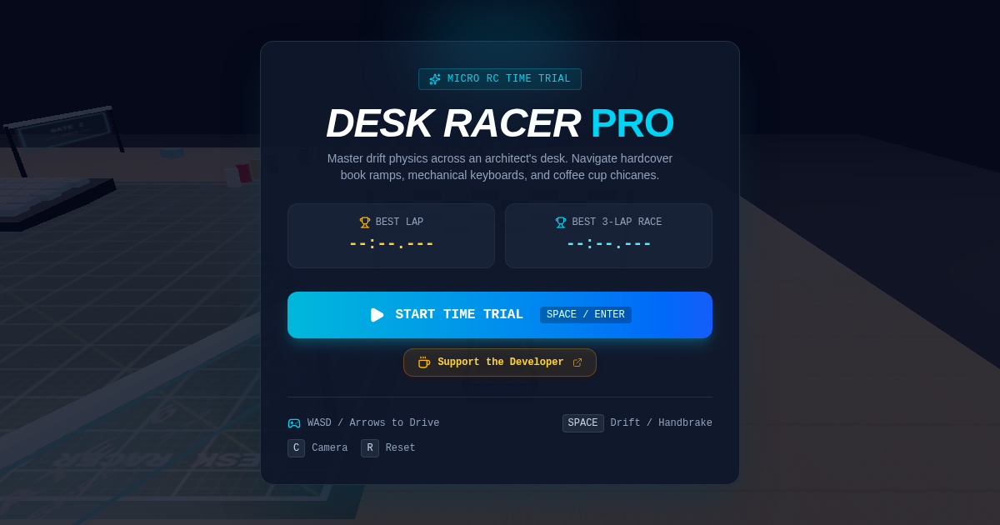

# 🏎️ Desk Racer Pro — Micro RC Time Trial

<p align="center">
  
</p>

<p align="center">
  <strong>High-performance, procedural 3D micro RC drift racing game built for the web.</strong><br>
  Engineered with Three.js, React 19, TypeScript, and procedural Web Audio API synthesizers.
</p>

<p align="center">
  <a href="https://deskracer.github.io/"></a>
  <a href="LICENSE"></a>
  
  
  
  <a href="https://ko-fi.com/kishara"></a>
</p>

---

## 🌟 Overview

**Desk Racer Pro** is an arcade-style micro RC time-trial simulator set on an architect's desk. Drift between hardcover books, slip past an oversized coffee mug hairpin, speed across a mechanical keyboard chicane, and cut tight lines under an articulated desk lamp's spotlight.

### 💡 Core Engineering Highlights

- **100% Client-Side & Zero Asset Dependencies**: Built without external `.glb`/`.gltf` model files or `.mp3` audio files that could 404 or fail to load. Every mesh (the RC chassis, spoiler, rotating suspension wheels, track barriers, checkpoint arches, and desk props) is procedurally generated using Three.js geometries and shaders.
- **Realistic Drift Kinematics**: Implements a customized bicycle physics model with forward acceleration, variable drag, proportional steering torque, lateral slip ratios, and handbrake drift dynamics.
- **Procedural Web Audio Engine**: Generates real-time brushless motor pitch modulation, variable tire screech noise, and resonant checkpoint chimes on the fly via the Web Audio API.
- **Decoupled 60 FPS Loop**: Keeps the Three.js physics and rendering loops strictly isolated from the React render cycle, guaranteeing smooth 60 FPS frame rates while streaming telemetry to a glassmorphic HUD.
- **100% SEO & Production Optimized**: Configured for `https://deskracer.github.io/` with complete Schema.org `VideoGame` structured data, OpenGraph/Twitter social cards, crawler-friendly semantic fallbacks, `robots.txt`, and XML sitemaps.

---

## 🎮 Controls

| Action | Primary Key | Secondary Key | HUD On-Screen Control |
| :--- | :---: | :---: | :--- |
| **Throttle / Accelerate** | `W` | `Up Arrow (↑)` | Accelerate |
| **Brake / Reverse** | `S` | `Down Arrow (↓)` | Reverse |
| **Steer Left** | `A` | `Left Arrow (←)` | Turn Left |
| **Steer Right** | `D` | `Right Arrow (→)` | Turn Right |
| **Handbrake Drift** | `Space` | — | Handbrake Button |
| **Toggle Camera View** | `C` | — | Camera Mode Button |
| **Reset Car to Last Checkpoint** | `R` | — | Reset Button |
| **Toggle Audio Synthesizer** | `M` | — | Audio Toggle Button |

---

## 📐 Track & Features

1. **Procedural RC Drift Car**:
   - Sleek aerodynamic chassis with front splitter, rear spoiler, and glowing LED headlights and brake lights.
   - 4 independently rotating rubber tires with steering angle animation on front wheels.
   - Dynamic chassis pitch (squat on acceleration, dive on braking) and body roll when cornering.
   - Active tire smoke and dust particle emitters that trigger when the lateral drift slip exceeds thresholds.

2. **Architect's Desk Circuit**:
   - **Elevated Book Bridge**: Double-layer hardcover book ramps testing vertical momentum and suspension.
   - **Ceramic Coffee Mug Hairpin**: Tight technical turn around an oversized mug with glossy ceramic shaders.
   - **Mechanical Keyboard Chicane**: High-speed S-turn weaving through keyboard keycaps.
   - **Articulated Desk Lamp**: Real-time warm spotlight casting dynamic soft shadows (`PCFSoftShadowMap`).
   - **Dominos & Erasers**: Boundary walls, ruler railings, and foam eraser bumpers with elastic collision response.

3. **Multi-Camera Director**:
   - **Chase Cam (Default)**: Dynamic third-person spring camera that widens FOV as velocity increases.
   - **Isometric Cam**: Miniature toy-perspective view capturing the entire desk layout.
   - **Hood Cam**: High-octane bumper-level perspective for pure speed sensation.

4. **Interactive Circuit Radar Minimap**:
   - Real-time 2D track layout overlay with sequential checkpoint indicators.
   - Live directional player chevron oriented to car heading.

5. **Time Trial & Split Delta System**:
   - 3-lap racing format with sequential checkpoint validation (prevents cutting across the desk).
   - Real-time delta comparison against your personal best lap.
   - Persistent Best Lap Time and Best Overall Race Time saved in browser `localStorage`.
   - Post-race victory celebration with celebratory confetti and performance breakdown.

---

## 🛠️ Tech Stack

- **Rendering**: [Three.js](https://threejs.org/) (WebGLRenderer, PCFSoftShadowMap, ACESFilmicToneMapping)
- **Framework**: [React 19](https://react.dev/) + [TypeScript](https://www.typescriptlang.org/)
- **Build Tool**: [Vite 8](https://vitejs.dev/) (Client-side static bundle)
- **Styling**: [Tailwind CSS v4](https://tailwindcss.com/)
- **Icons**: [lucide-react](https://lucide.dev/)
- **Animation & Effects**: [canvas-confetti](https://www.npmjs.com/package/canvas-confetti), [motion](https://motion.dev/)
- **Audio**: Web Audio API (Synthesizers: Polyphonic Oscillators, BiquadFilter, White Noise Buffer)
- **Testing**: Node.js Test Runner (`node:test`, `tsx`)

---

## 🚀 Getting Started

### Prerequisites

- [Node.js](https://nodejs.org/) (v18.0.0 or later recommended)
- `npm` (v9 or later)

### Installation

1. **Clone the repository**:
   ```bash
   git clone https://github.com/<your-username>/deskracer.github.io.git
   cd deskracer.github.io
   ```

2. **Install dependencies**:
   ```bash
   npm install
   ```

3. **Start the local development server**:
   ```bash
   npm run dev
   ```
   Open [http://localhost:3000](http://localhost:3000) in your browser.

---

## 🧪 Testing

Desk Racer Pro maintains decoupled unit tests for pure physics calculations, collision detection, and track checkpoint sequencing:

```bash
# Run automated unit tests
npx tsx --test src/game/physics.test.ts src/game/track.test.ts

# Run TypeScript type check
npm run lint
```

---

## 🌐 Deploying to GitHub Pages (`deskracer.github.io`)

Because Desk Racer Pro is a **100% client-side static application**, it requires zero backend servers and can be hosted for free on GitHub Pages.

### Option A: Automatic Deployment via GitHub Actions (Recommended)

This repository includes an automated workflow at `.github/workflows/deploy.yml`.

1. Push your repository to GitHub:
   ```bash
   git add .
   git commit -m "feat: Desk Racer Pro release"
   git push origin main
   ```
2. Enable GitHub Pages:
   - Navigate to your repository on GitHub.
   - Go to **Settings** → **Pages**.
   - Under **Build and deployment** → **Source**, select **GitHub Actions**.
3. GitHub Actions will automatically build and publish your site to `https://deskracer.github.io`.

### Option B: One-Command CLI Deployment

Deploy directly from your terminal using the built-in `gh-pages` script:

```bash
npm run deploy
```

---

## 📁 Project Structure

```text
├── .github/
│   └── workflows/
│       └── deploy.yml          # Automated GitHub Pages CI/CD workflow
├── public/
│   ├── CNAME                   # Custom domain pointer (deskracer.github.io)
│   ├── favicon.svg             # Vector RC car favicon
│   ├── og-image.png            # 1200x630 social sharing card image
│   ├── og-image.svg            # Vector source for social banner
│   ├── robots.txt              # Search engine crawler permissions
│   ├── site.webmanifest        # PWA application manifest
│   └── sitemap.xml             # XML search engine sitemap
├── src/
│   ├── audio/
│   │   └── SoundManager.ts     # Procedural Web Audio API sound synthesizers
│   ├── components/
│   │   ├── CanvasView.tsx      # React wrapper mounting Three.js scene
│   ├── HUD.tsx                 # Glassmorphic telemetry HUD overlay
│   │   ├── Minimap.tsx         # Real-time 2D circuit radar minimap
│   │   ├── TitleScreen.tsx     # Start race menu & controls guide
│   │   └── VictoryModal.tsx    # Lap time breakdown & confetti modal
│   ├── game/
│   │   ├── CameraController.ts # Spring-lerped multi-mode camera rig
│   │   ├── CarMesh.ts          # Procedural 3D RC car geometry & materials
│   │   ├── Environment.ts      # Desk surface, studio lighting & obstacles
│   │   ├── PhysicsEngine.ts    # Raycast arcade drift kinematics & collisions
│   │   ├── SceneManager.ts     # 60 FPS master animation & render orchestrator
│   │   ├── TrackManager.ts     # CatmullRom spline circuit & checkpoint gates
│   │   ├── physics.test.ts     # Kinematics and collision unit tests
│   │   └── track.test.ts       # Checkpoint progression & timing tests
│   ├── App.tsx                 # Root application state & telemetry bridge
│   ├── main.tsx                # React entry point
│   └── index.css               # Tailwind CSS imports & custom styles
├── index.html                  # SEO metadata, Google tag (gtag.js) & schema.org
├── LICENSE                     # MIT License
├── package.json                # Project dependencies & build scripts
├── tsconfig.json               # TypeScript compiler configuration
└── vite.config.ts              # Vite configuration with relative base paths
```

---

## ☕ Support the Developer

If you enjoy drifting around the desk or find this procedural WebGL codebase helpful, consider supporting future development:

<p align="center">
  <a href="https://ko-fi.com/kishara">
    
  </a>
</p>

- **Ko-fi**: [https://ko-fi.com/kishara](https://ko-fi.com/kishara)

---

## 📄 License

This project is open-source and available under the [MIT License](LICENSE).

Copyright (c) 2026 **Kishara**.
